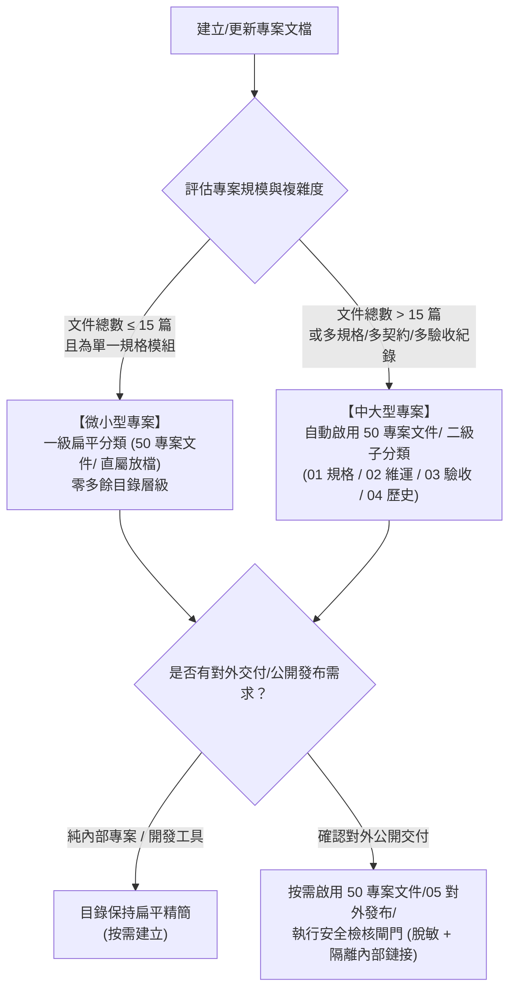

# Obsidian 分類架構與自適應路由治理指南 (Taxonomy Guide)

本文件定義專案文件在 Obsidian 中的分類原則、專案規模自適應門檻機制、對外發布與交付協議、Day-2 持續變更治理，以及解決 AI Dataview 盲區的開局進度追蹤標準。

---

## 1. Project-First 與目錄層級原則

所有與專案相關的文件，一律依照專案類型與命名規則，有序存放於對應的專案層級目錄中，維持 Vault 根目錄的整潔與結構化。

### 1.1 專案命名規範（年份-月份_專案名稱）
專案資料夾一律採用「年份-月份_專案名稱」格式：
- 格式：`YYYY-MM_<專案名稱>`
- 範例：`2026-10_ecommerce-web`、`2026-10_cli-tool`

### 1.2 專案類型分流與頂層目錄架構

1. **SKILL 技能開發專案**：
   - 第一層：`※_SKILL/`（所有技能專案專屬母目錄）
   - 第二層：`YYYY-MM_<專案名稱>/`（例如 `※_SKILL/2026-10_data-scraper/`）
   - 第三層起：該專案之分類目錄與文件（例如 `※_SKILL/2026-10_data-scraper/50 專案文件/`）

2. **一般專案（非 SKILL）**：
   - 第一層：`YYYY-MM_<專案名稱>/`（直接在 Vault 根目錄建立，例如 `2026-10_ecommerce-web/`）
   - 第二層起：該專案之分類目錄與文件（例如 `2026-10_ecommerce-web/50 專案文件/`）

3. **外部評估與資源調研（獨立頂層庫）**：
   - 第一層：`※_外部評估/`（全域專用評估中樞，獨立於單一開發專案）
   - 第二層：`<大主題領域>/`（例如 `01_AI與提示詞/`、`02_資安與檢測/`、`03_生活與訂閱服務/` 等，AI 自動判斷或動態建立）
   - 第三層（檔案）：`EVA-YYYYMMDD-<主題名稱>-<來源類型>.md`（例如 `EVA-20261006-PromptGenius-Chrome插件.md`）

### 1.3 目錄判定與分流流程
1. **識別對象性質**：
   - 外部網址、Chrome 插件、第三方 GitHub 倉庫或網路服務之安全性/功能性評估 ➔ 目標路徑為 `※_外部評估/<大主題領域>/`。
   - Antigravity/Codex SKILL 技能開發專案（如路徑包含 `=skill`、或產出為 `SKILL.md`） ➔ 目標路徑為 `※_SKILL/<YYYY-MM_專案名稱>/`。
   - 一般工程專案 ➔ 目標路徑為 `<Vault>/<YYYY-MM_專案名稱>/`。
2. **全新目錄確認**：先向使用者確認專案、分類與目標路徑。建立專案時只建專案地圖；其他分類目錄在第一次有已授權筆記時才建立。

### 1.4 實體專案程式庫與 Obsidian 資料夾雙向綁定機制 (Project-to-Vault Mapping)

為解決本機程式碼專案資料夾名稱（如 `obsidian-docs`）與 Obsidian 資料夾名稱（如 `2026-09_obsidian-docs`）因年月前綴、歷史名稱或特定母目錄不一致而導致 AI 誤判路徑的痛點，建立以下雙向綁定標準：

1. **Repo 端記錄對應路徑（最高優先級 SSOT）**：
   - 在專案程式碼儲存庫的本地說明文件（如 `docs/PROJECT.md` 或 `README.md`）中，明確記載對應的 Obsidian 資料夾路徑：
     ```markdown
     ## 知識庫與文件 (Obsidian Documentation)
     - Obsidian 專案路徑：`2026-10_ecommerce-web`
     - Obsidian 專案地圖：`2026-10_ecommerce-web/10 專案地圖/MAP-ecommerce-web.md`
     ```
   - AI 在開局識別專案時，優先讀取此本地文件；若已指定路徑，直接精準鎖定目標 Obsidian 資料夾，免除跨年月或命名差異造成的偏差與重複建檔。

2. **Obsidian 專案地圖單向記載本地關聯**：
   - 在 Obsidian 的 `10 專案地圖/MAP-<專案名稱>.md` 第 1 章專案概況中，以文字註明本地文件的相對路徑（如 `本地專案說明文件: docs/PROJECT.md`）。
   - 此專案說明文件屬於本地程式碼庫專有資產，無需同步寫入 Obsidian，專案地圖僅作為追溯關聯標記。

---


## 2. 專案規模自適應門檻機制 (Adaptive Scale Threshold)

為兼顧「微型工具的極簡敏捷」與「大型企業系統的嚴格管制」，本技能依專案複雜度與文檔規模實施自適應動態演進，絕不預先過度設計：



### 2.1 微小型專案（檔案數 ≤ 15 篇）
- **架構特徵**：維持完全扁平的一級目錄分類（`00 收件匣/`～`90 索引/` 直屬放置 Markdown 檔案）。
- **心智負擔**：零額外子資料夾。例如：`50 專案文件/SPEC-產品規格.md`、`50 專案文件/CHANGELOG.md`。
- **適用場景**：自動化腳本、小型 CLI 工具、原型驗證 (PoC)、個人單一模組小專案。

### 2.2 中大型專案（檔案數 > 15 篇，或具多模組規格／契約時）
當專案文件總數超過 15 篇，或同時出現多份模組規格、API/資料契約、跨系統整合架構與多份驗收報告時，自動啟用 `50 專案文件/` 的標準二級子分類架構（維持至多兩層目錄，完全符合 MECE 原則）：

| 二級目錄名稱 | 角色與職責 (MECE 分類) | 存放文件範例 |
|---|---|---|
| `50 專案文件/01 規格與契約/` | **現行生效的基準規格與契約 (Living Docs / SSOT)**：產品功能規格、資料模型契約、跨系統 API 規格、架構設計基準。 | `SPEC-核心購物車.md`、`CONTRACT-金流Webhook.md`、`ARCH-分散式快取架構.md` |
| `50 專案文件/02 維運與指南/` | **維運手冊、標準作業程序與變更歷程**：部署 SOP、災難復原指引、快速上手指南、CHANGELOG、環境建置說明。 | `CHANGELOG.md`、`GUIDE-開發者上手指南.md`、`SOP-生產環境部署.md` |
| `50 專案文件/03 驗收紀錄/` | **不可抹滅的品質佐證與驗收證據**：工程驗收矩陣、跨模組集成測試報告、資安修復查核表、效能基準驗證結果。 | `AC-MATRIX-v1.0.md`、`VERIFY-金流壓力測試報告.md` |
| 50 專案文件/04 審閱歷史/ | **階段性過渡稿與歷史審核存檔 (ISO 9001 文件管制)**：專門收錄已結案之重大 RFC 草案、已被新版取代的規格與討論階段候選方案，**確保現行生效規格維持純粹與唯一權威**。 | DRAFT-20261001-舊版金流架構草稿.md、REV-HIST-結帳重構討論稿.md |

> [!NOTE]
> **平滑過渡原則 (In-place Migration)**：
> 從微型專案跨越門檻擴充至中大型二級子分類時，採取就地平滑歸類，並同步將相關 Wiki-link 調整為新路徑（如 `[[50 專案文件/01 規格與契約/SPEC-產品規格|產品規格]]`），確保所有既有雙向連結依然暢通。

---

## 3. 對外發布與交付協議 (Release Protocol - 按需啟用)

本規範遵循 ISO 27001 資訊資產保護與最小外洩原則，嚴格區隔內部設計資產與外部交付產物：

### 3.1 按需原則 (On-Demand Activation Only)
- **內部專案按需原則**：凡純內部使用工具、企業內部服務或尚未對外發布之早期原型，維持扁平精簡，**僅在確定有對外交付產物時啟用對應目錄**。
- **發布目錄標準**：僅在專案確認具備對外交付、開源發行、或交付客戶之產物需求時，按需在 `50 專案文件/` 下啟用：
  - `50 專案文件/05 對外發布/`：專門存放經脫敏過濾的對外交付物（如純淨版使用手冊 `USER-GUIDE.md`、公開發布說明 `RELEASE-NOTES-v1.0.md`、隱私條款與免責聲明 `PRIVACY-POLICY.md`）。

### 3.2 發布安全檢核閘門 (Release Gate Checklist)
在將任何文檔標記為 `狀態: 已發布` 或放入 `05 對外發布/` 之前，AI Agent 必須嚴格執行發布安全雙重檢核：

1. **敏感資訊去識別化 (Sanitization & De-identification)**：
- 一律使用通用相對路徑或去識別化路徑（避免出現本機硬碟與使用者目錄）。
   - 脫敏所有內部私有網路 IP、內部 Port、內部網域名稱（例如 `192.168.x.x`、`10.x.x.x`、`corp.internal`）。
   - 脫敏或移除所有資料庫連線字串、測試 Token、API Key、開發者個人帳密，一律置換為標準佔位符（如 `<your-api-key>`、`https://api.example.com`）。
2. **內部 Wiki-link 隔離防線 (Internal Link Isolation & Dead-link Prevention)**：
- **保持發布文件完全自包含**：公開交付文件僅引用對外發布目錄下之公開文件，確保外部讀者閱覽順暢並維護內部專案資訊邊界。
   - **轉換標準**：內部鏈接必須轉換為自包含章節錨點（如 `[核心概念說明](#核心概念說明)`）、純文字說明，或僅鏈結同屬 `50 專案文件/05 對外發布/` 目錄下的公開文件。

---

## 4. 發布後持續變更治理 (Day-2 Change Management)

軟體系統上線發布後，文件的維護必須遵循嚴謹的 Doc-as-Code 與 ISO 9001 管制程序：

### 4.1 活文檔單一事實來源原則 (Living Document / SSOT)
- **活文檔單一事實來源**：規格變更時，一律採單一檔案就地演進，透過文件內修訂歷程與版本號追蹤，維持單一事實來源。
- **就地更新＋版本註記**：所有功能迭代一律在現行基準規格（如 `SPEC-產品規格.md`）中就地修訂，並同步更新 Frontmatter 的 `修改日期` 與 `對應版本`。

### 4.2 ISO 廢棄與刪除程序 (Deprecation Protocol)
- **變更全量可追溯**：歷史規格或已實現的功能若在後續版本廢除，於規格章節明確標註廢棄狀態並記載於變更紀錄。
- **廢棄標記規範**：
  1. 規格內文中針對已廢棄功能加上警示 Callout 或刪除線標記：
     ```markdown
     > [!WARNING] [已廢棄] 本介面自 v1.2.0 起停用
     > 原 `legacyAuth()` 已由 `oauth2Authorize()` 取代，詳情參閱 [[50 專案文件/01 規格與契約/SPEC-認證服務|SPEC-認證服務]]。
     ```
  2. 同步在 `CHANGELOG.md` 當前版本章節中明確記錄於 `### 移除 (Removed)` 或 `### 廢棄 (Deprecated)` 清單中。
  3. 若整篇規格完全廢棄，將 Frontmatter 更新為 `狀態: 已廢棄`，填入 `廢棄替代: "[[新規格]]"`，並可將該文檔移入 `50 專案文件/04 審閱歷史/` 歸檔。

### 4.3 工單流水號全週期自然遞增
- `60 協作任務/` 下的工單編號（`COLLAB-001`、`DEV-001`、`FIX-001`）為全專案生命週期的永久唯一識別碼。
- **流水號自然遞增**：即使經歷重大版本發布（例如從 v1.0 升級至 v2.0），工單編號持續自然連續遞增（如接續為 COLLAB-045），維持專案歷史 Git Commit 與 PR 關聯的一致性。

### 4.4 上線後資安審查與例行巡檢
- `70 資安審查/` 採事件驅動流水號延續記錄（如 `SEC-001`、`SEC-002`、`SEC-003`）。
- 軟體發布後之定期弱點複測、相依套件重大 CVE 修補、例行滲透測試報告，皆接續編號建檔，形成不可抹滅的長期安全稽核軌跡。

---

## 5. 開局進度盤點與換窗接力（解決 AI Dataview 盲區）

### 5.1 專案地圖「現況焦點指針 (Active Focus Callout)」機制
Obsidian 的 Dataview 插件依賴前端動態執行 JavaScript/DQL 渲染，AI Agent 讀取 Markdown 原始碼時無法解析動態渲染結果（形成致命的 Dataview 盲區）。

為徹底解決此瓶頸，**規定 `10 專案地圖/MAP-<專案名稱>.md` 之 YAML Frontmatter 下方第一行（標題下方），必須強制維護靜態 `> [!FOCUS]` 現況焦點指針區塊**：

```markdown
> [!FOCUS] 現況焦點指針 (Active Focus)
> - **當前目標里程碑**：v1.0.0 核心購物車與金流結帳串接上線
> - **進行中任務卡**：[[60 協作任務/COLLAB-003-金流Webhook串接|COLLAB-003 金流Webhook串接]]
> - **最新中斷點**：已完成藍新金流回傳簽章驗證演算法，停在訂單付款狀態異步更新邏輯 (`order.service.ts:48`)
> - **下一步行動**：補齊資料庫交易樂觀鎖並撰寫單元測試驗證通過
```

### 5.2 AI 開局三層精準盤點（輕量化與解耦巨型規格）
當新對話開啟或接手既有專案時，AI Agent 遵循極速輕量化開局流程，大幅節省 Token 並精準還原現場：
1. **第一步（指針定位）**：讀取 `10 專案地圖/MAP-<專案名稱>.md` 頂部的 `> [!FOCUS]` 區塊，3 秒內掌握當前里程碑、活躍任務與最新斷點。
2. **第二步（精準聚焦當前工作）**：有進行中任務卡時讀取其驗收與交接章節；無任務卡時讀取 `[!FOCUS]` 指向的當前文件。
3. **第三步（精確按需讀取）**：依當前工作來源引用的特定章節或關聯契約精準閱讀，維持 Context 聚焦並節省 Token。

### 5.3 工單庫累積超過 30 篇之結案歸檔機制 (Issue Archiving Threshold)
- **觸發門檻**：當 `60 協作任務/` 目錄下的工單總數超過 30 篇時，自動啟用歸檔機制。
- **歸檔標準**：凡依驗收標準與實際證據結案且標記為 `狀態: 完成` 之歷史工單，允許批次歸檔至二級目錄：
  - `60 協作任務/已結案/`（例如 `60 協作任務/已結案/COLLAB-001-架構初始化.md`）。
- **效益**：確保 `60 協作任務/` 根目錄僅保留活躍中之待辦、進行中與待審閱工單，提升 AI 檢索效率與側邊欄瀏覽體驗。

---

## 6. 標準分類目錄全貌與命名規範

### 6.1 目錄架構全景表

| 目錄路徑 | 專案規模與職責說明 | 檔案命名與內容範例 |
|---|---|---|
| `00 收件匣/` | 通用：尚未分類的原始資料、快速速記、臨時想法 | `INBOX-20261001-靈感速記.md` |
| `05 範本/` | 選用：專案專用範本（特殊需求時自訂，預設無需建立） | `TMPL-特殊資料模型.md` |
| `10 專案地圖/` | 通用：專案核心導航、**頂部 [!FOCUS] 指針**、Dataview 總覽 | `MAP-<專案名稱>.md` (如 `MAP-ecommerce-web.md`) |
| `15 需求訪談/` | 通用：需求澄清、訪談問答、所有選項與最終選擇紀錄 | `INTV-001-結帳流程訪談.md` |
| `20 研究/` | 通用：技術調研、競品分析、文檔整理、實驗結果 | `RES-001-向量資料庫比較.md` |
| `30 AI 提案/` | 通用：AI 提出的架構草案、未定案建議、供人審閱方案 | `PROP-001-快取策略重構.md` |
| `40 跨專案決策/` | 通用：影響兩個以上專案的架構決策 (ADR) | `ADR-001-統一使用UTF8編碼.md` |
| `50 專案文件/` | **微小型專案**：扁平直屬存放規格、SOP、變更紀錄、使用指南 | `SPEC-產品規格.md`、`CHANGELOG.md`、`GUIDE-快速上手.md` |
| `50 專案文件/01 規格與契約/` | **中大型專案**：生效中基準規格、API 契約、資料架構 (SSOT) | `SPEC-訂單服務.md`、`CONTRACT-金流介面.md` |
| `50 專案文件/02 維運與指南/` | **中大型專案**：維運手冊、部署 SOP、災備手冊、CHANGELOG | `CHANGELOG.md`、`SOP-生產環境部署.md` |
| `50 專案文件/03 驗收紀錄/` | **中大型專案**：工程驗收矩陣、跨模組整合測試驗證報告 | `AC-MATRIX-v1.0.md`、`VERIFY-整合驗證報告.md` |
| `50 專案文件/04 審閱歷史/` | **中大型專案**：過渡稿、已結案 RFC、已被新規格取代的舊稿 | `DRAFT-過渡討論稿.md`、`REV-HIST-舊版架構.md` |
| `50 專案文件/05 對外發布/` | **按需啟用**：純淨版手冊、公開 Release Notes、隱私免責聲明 | `USER-GUIDE.md`、`RELEASE-NOTES-v1.0.md` |
| `60 協作任務/` | 通用：任務卡、指派範圍、進度斷點（> 30 篇可移入 `已結案/`） | `COLLAB-001-架構初始化.md`、`DEV-001-登入實作.md` |
| `60 協作任務/已結案/` | 選用：累積超過 30 篇時，經實質驗收通過結案之任務工單存檔 | `COLLAB-001-架構初始化.md` |
| `70 資安審查/` | 首篇必備資安總覽儀表板，後續存放具體檢測與修復報告 | `SEC-000-資安審查總覽.md`、`SEC-001-CodeQL掃描報告.md` |
| `90 索引/` | 通用：專案內部特定主題導航索引或標籤目錄 | `INDEX-API導航.md` |
| `assets/` | 通用：圖片與多媒體資產（線框圖、架構圖，以 `![[assets/xxx.png]]` 引用） | `UI-購物車線框圖.png` |

---

## 7. Wiki-link 結構化路徑別名與雙向織網矩陣

### 7.1 Wiki-link 引用規範
在 Obsidian 內部建立 Wiki-link 時，一律包含路徑與別名，確保精準跳轉且全 Vault 路徑唯一：
- 微小型專案：`[[50 專案文件/SPEC-產品規格|產品規格]]`、`[[50 專案文件/CHANGELOG|變更紀錄]]`
- 中大型專案：`[[50 專案文件/01 規格與契約/SPEC-核心購物車|SPEC-核心購物車]]`、`[[50 專案文件/02 維運與指南/CHANGELOG|變更紀錄]]`
- 對外發布文件：`[[50 專案文件/05 對外發布/USER-GUIDE|使用者手冊]]`（發布文檔內僅限引用公開文件）
- 任務與資安：`[[60 協作任務/COLLAB-001-架構初始化|COLLAB-001 架構初始化]]`、`[[70 資安審查/SEC-001-CodeQL報告|SEC-001 CodeQL]]`
- 外部評估：`[[※_外部評估/01_AI與提示詞/EVA-20261006-PromptGenius-Chrome插件|EVA-20261006 PromptGenius]]`

### 7.2 雙向織網關聯矩陣 (Interlinking Matrix)

| 建立之筆記類型 | 主動建立之向前連結 (Outgoing) | 任務推進或完成後回填之反向連結 (Backlink) |
|---|---|---|
| `15 需求訪談/` | 已存在的衍生規格與專案地圖 | 定案時回填真實關聯之基準規格連結 |
| `60 協作任務/` | 已存在的需求、基準規格與前期研究 | 任務卡持有進度狀態；專案地圖透過頂部 `[!FOCUS]` 與 Dataview 同步 |
| `20 研究/` | 參考資料外部 URL、競品連結 | 產出架構方案後，填寫落地之 `[[60 協作任務/COLLAB-xxx\|任務卡]]` |
| `50 專案文件/SPEC` | `[[15 需求訪談/INTV-xxx\|需求訪談依據]]`、`[[20 研究/RES-xxx\|前期調研]]` | 功能落實時，勾選 AC 並補充已驗收結案之 `[[60 協作任務/COLLAB-xxx\|任務卡]]` |
| `70 資安審查/` | 已存在的修復任務與變更紀錄 | 在對應任務卡回填驗收與複測證據 |

---

## 8. 圖表視覺沉澱與版面純淨排版最佳實踐

1. 視覺保真：凡對話中為使用者產生的 Mermaid 圖表、結構化表格、Callout 區塊，寫入 Obsidian 時完整保留原始視覺語法。
2. 圖表寬度與響應式：
   - 流程圖寬度控制在 1200px 內。
   - 子圖明確宣告 `direction TB`。
   - 使用隱形錨點 `A ~~~ B ~~~ C` 垂直整齊堆疊無因果節點。
   - 超過 3 步驟的線性流程採用 `flowchart TB`。
   - 屬性比對與規格清單優先使用 Markdown 原生表格（`| ... |`）。
3. 排版純淨與無多餘星號原則 (Asterisk Minimalism)：
   - 依靠 Markdown 自然標題層級（`#`、`##`、`###`）與結構化清單呈現資訊層次。
- 條列清單項目開頭一律採用自然書寫（例如 - 項目：...），維持版面清爽自然。
   - 粗體星號（`**`）僅保留於極少數需要強烈警示之關鍵字詞，維持版面純淨與專業閱讀體驗。


---

## 9. 評估與審查成果主動落盤判定矩陣 (Evaluation Archiving Decision Matrix)

為落實知識資產的長期沉澱價值，引導 AI Agent 在產出評估成果時主動推進知識落盤，建立以下標準判定與歸檔路徑：

### 9.1 評估意圖與目標目錄分流矩陣

| 使用者意圖與評估情境 | 目標歸檔目錄與命名規範 | 核心職責與必備章節 |
|---|---|---|
| 專案資安檢測、代碼安全審計、弱點掃描規劃 | <專案>/70 資安審查/SEC-<流水號>-<主題>.md | 審查目標、檢測維度與工具清單、現況弱點評估、加固行動建議 |
| 專案技術選型、架構可行性評估、競品方案調研 | <專案>/20 研究/RES-<流水號>-<主題>.md | 調研背景、候選技術多維比對、優缺點分析、架構建議與落地方案 |
| 系統重構草案、模組優化評估、效能改善提案 | <專案>/30 AI 提案/PROP-<流水號>-<主題>.md | 當前瓶頸分析、重構設計草案、衝擊範圍評估、待審查決策點 |
| 外部 GitHub 專案、Chrome 插件、SaaS 工具評估 | ※_外部評估/<大主題領域>/EVA-<YYYYMMDD>-<主題>-<類型>.md | 產品功能概況、授權與資安風險、可行性評分、建議使用場景 |

### 9.2 對話與落盤雙重交付標準
1. 完整落盤為先：凡產出具備深度的分析、評估、架構方案或審查檢測內容，Agent 應同步透過 Obsidian MCP 工具建立或更新對應筆記，確保知識資產持久保存。
2. 對話提供摘要：在聊天視窗中提供重點摘要、關鍵結論與行動選項，避免使用者被巨量內文淹沒。
3. 結尾附帶跳轉連結：回覆末尾依照純淨原則提供 > [!NOTE] 跳轉 Callout（obsidian://open?vault=...），指引用戶一鍵進入 Obsidian 檢閱完整評估報告。

### 9.3 資安審查總覽 (SEC-000) 與專案地圖解耦規範

1. 首篇必備原則：
   - 專案建立 70 資安審查/ 目錄時，首篇必須建立 70 資安審查/SEC-000-資安審查總覽.md（採用 
`resources/templates/資安總覽.md` 範本）。
   - 該文件作為專案資安的唯一事實來源 (SSOT) 與態勢儀表板，集中統籌所有工具檢測覆蓋矩陣、未解弱點追蹤表與歷次報告索引。
2. 狀態解耦、職責分離與態勢誠實表達：
   - 放行建議與發布授權分離：資安檢測通過僅代表達到技術安全門檻（資安放行建議：建議放行 / 條件式放行 / 不建議放行 / 未評估）；絕不代表已取得 commit、部署、公開發布、DNS 或雲端設定變更授權（實際發布授權：已授權 / 未授權 / 條件式授權 / 不適用）。
   - 弱點三軸獨立追蹤：Findings 表格分開記錄「弱點確認狀態」（待確認／已確認／誤報）、「修復狀態」（待修復／修復中／已修復／接受風險／不適用）與「複測狀態」（未複測／通過／未通過／不適用）。
   - SEC-000 統計分流與誠實原則：統計明確區分為：(1) 目前未結案的 Critical／High／Medium／Low／Info；(2) 已修復；(3) 接受風險；(4) 誤報；(5) 未受測範圍。只有實際受測的範圍才能填 0；尚未檢測的範圍標示為未知或 NOT_TESTED。
   - 密等分級治理 (ISO 27001)：脫敏資安摘要預設為「內部使用」；若含可利用弱點 PoC、真實帳戶資訊、內部拓撲或敏感路徑時標為「機密」；對外版本須另行於發布目錄完成去識別化脫敏及發布審查並標為「公開」。
   - 原始報告與受控證據管制：原始掃描報告優先保存在 Git repo 與 Obsidian Vault 之外。若保存在 repo 內，須確認已排除於 Git、建置產物及部署內容，並移除 Cookie、token、Session、私人郵件、帳戶識別資訊及完整請求內容。Vault 內只保留脫敏摘要、檔案完整性雜湊 (SHA-256)、保存期限與受控位置說明。
   - 資料清理與銷毀標準：依儲存媒體與平台採用可驗證的永久刪除、加密金鑰銷毀或組織核准的資料清理程序。

3. 三步聯動 SOP 與專案地圖精準收斂（保持地圖輕量）：
   - 每次執行新的資安審查時，依序完成：
     1. 撰寫具體報告：建立或更新具體檢測報告（如 70 資安審查/SEC-<編號>-<主題>.md）。
     2. 總覽儀表板同步更新：在 SEC-000-資安審查總覽.md 更新安全水位評級、未解弱點清單、工具矩陣與歷次索引。
     3. 專案地圖精準收斂：10 專案地圖/MAP-<專案名稱>.md 頂部的 > [!FOCUS] 僅保留一句最新資安態勢指標及 SEC-000 連結（例如：最新資安態勢：最新通過 SEC-003，全局 0 High，DAST 待複測，詳見 [[70 資安審查/SEC-000-資安審查總覽|SEC-000]]）；工具版本、掃描歷程、弱點詳情與實測證據集中放在 SEC-000 和個別 SEC 報告，保持地圖輕量與專注。

